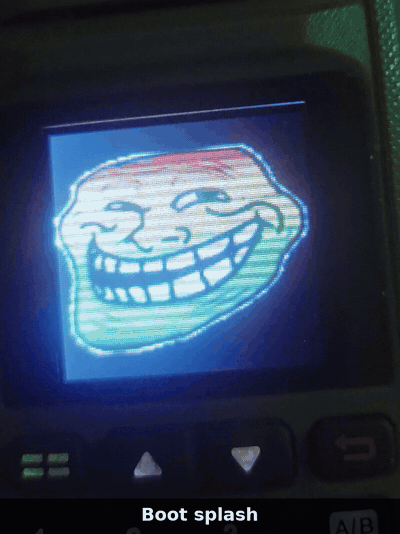
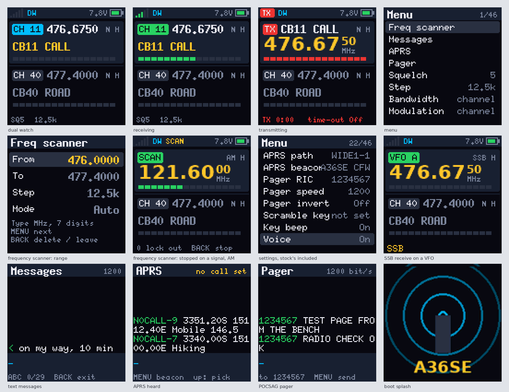

# Talkpod Super Firmware

> [!WARNING]
> **Check the law before you install or use this firmware.**
> - Only transmit on frequencies you are licensed or otherwise permitted to use, and only with the
>   power, bandwidth and modes that permission allows.
> - This firmware removes the radio's factory band limits. It can transmit across 18–660 and
>   840–1300 MHz; only 108–138 MHz (aviation) and 406.0–406.1 MHz (distress beacons) are blocked.
>   Transmitting where you aren't permitted can interfere with emergency, aviation and other services,
>   and is illegal.
> - In some jurisdictions radio equipment must keep its type approval (certification). Replacing the
>   radio's firmware can void it, and merely having this firmware running on a radio may be illegal,
>   even if you never transmit. Check your local rules (for example ACMA in Australia, the FCC in the
>   US, Ofcom in the UK) before installing it.
> - It is provided for research, as is, without any warranty. You are responsible for how you use it.

Replacement firmware for the **Talkpod A36SE** (sold as the A36plus 5 W), written from scratch for
radio research. It keeps the radio's everyday functions, with the stock menu settings, and adds:
- a two-slot user interface with dual watch;
- a frequency scanner over any range, in FM, AM or Auto (AM on airband and 27 MHz CB);
- SSB receive on a VFO slot;
- text messaging compatible with UV-K5 radios, APRS and POCSAG paging;
- Morse code sending, 5–40 words per minute;
- texts sent before, recalled on any typing screen (hold FM) and kept through power-off;
- squelch levels from weak stations (level 1) to strong ones only (level 9);
- a receiver event log, read and explained by [Talkpod Manager](https://github.com/ssjrocks/talkpod-manager);
- a wide transmit range;
- an animated boot splash.

Version **1.26**. Builds to about 61 KB of the MCU's 63 KB application flash.

[](https://github.com/ssjrocks/talkpod-super-firmware/raw/main/docs/media/tour.mp4)

*Filmed on a real radio running 1.17, sped up: boot splash, dual watch, the menu, the frequency scanner
and a channel scan. The splash is any animation you send it; this one is the owner's. Click to download a sharper MP4.*



*Version 1.26 running in the emulator (`tools/screens.sh`).*

> **Transmit range in detail.** The firmware transmits wherever the BK4819 can synthesise, except
> the two ranges hard-blocked in code (`src/tx.c`). It was developed with the radio in a shielded
> enclosure on a dummy load. The transmit power calibration is the radio's own, but spectral purity
> off the radio's designed bands has not been measured.

## Contents

| Document | What is in it |
|---|---|
| [docs/user-guide.md](docs/user-guide.md) | Screens, keys, menu, messaging, APRS, pager, splash |
| [docs/hardware.md](docs/hardware.md) | Everything learned about the radio: MCU, bootloader, pins, BK4819, RF switching, calibration, flash map, display, keys, audio |
| [docs/stock-firmware.md](docs/stock-firmware.md) | Reverse-engineering notes on the stock V1.22 Super firmware, with addresses |
| [docs/data-modes.md](docs/data-modes.md) | The BK4819 FSK modem as used here; UV-K5 messenger, APRS and POCSAG formats and implementations |
| [docs/serial-interface.md](docs/serial-interface.md) | Programming cable, flashing protocol, `.kdhx` format, the firmware's serial shell and event log, **the splash format and how Talkpod Manager uploads it** |
| [docs/morse.md](docs/morse.md) | The Morse signal exactly, for writing a decoder |
| [docs/development.md](docs/development.md) | Source layout, building, the Unicorn emulator and other tools, what is verified on hardware |

## Features

Each release was tested on the radio.

| | Status |
|---|---|
| FM receive, wide / narrow | working |
| AM receive (airband channels automatic, any VFO frequency on request) | working |
| Squelch 0–9 from the radio's own calibration; level 1 opens on weak stations stock muted, level 3 is about stock's level 1 (1.23) | working |
| Received audio at the radio's calibrated level, as stock (1.21; before, it clipped at any volume) | working |
| Signal meter: 16 segments of 6 dB, −125 to −29 dBm (1.21) | working |
| Tail cut on receive: the mute ends with the carrier, or half a second at most (1.22; before, tone bursts could leave the audio muted until PTT) | working |
| Dual watch (two slots, each a channel or a VFO frequency) | working |
| Frequency search (strongest nearby carrier) | working |
| Channel scan with lock-out | working |
| FM broadcast radio (BK1080) | working |
| SSB receive on a VFO slot, with 1 kHz to 10 Hz steps, for both sidebands | working |
| Stock's ENCRY, a private code squelch | working |
| Frequency scanner: a typed range and step, in FM, AM or Auto (AM on airband and 27 MHz CB), stops into VFO mode | working |
| FM transmit with the radio's PA calibration, high / low power, time-out timer | working (1.0–1.10 sent a silent carrier; fixed in 1.11) |
| Channels from Talkpod Manager / CHIRP: read and write over the stock programming protocol (1.1+) | working |
| Receiver event log, read over the cable (Talkpod Manager's Event log), with signal readings and weak stations the squelch kept out (1.23) | working |
| Per channel: transmit frequency (repeater shift, split), transmit-off, busy channel lockout | working |
| CTCSS / DCS sent and decoded (stock's register values), tone squelch in scan and dual watch | working |
| Voice scrambler: the UV-K5's ten inversion types (2600–3500 Hz) | working; weak: words stay partly understandable |
| Rolling scrambler: the inversion frequency glides along a keyed path (Super Firmware radios only) | working |
| UV-K5-compatible text messages (kamilsss655 format) with delivery receipts | working |
| APRS: beacons, messages, acks (AFSK 1200) | working |
| POCSAG pager, 512 / 1200 / 2400 bit/s, numeric and alphanumeric | working |
| Morse code sent as a 700 Hz tone (MCW), 5–40 WPM, 30 to start, up to 144 characters, without Roger or tail | working |
| Text lengths: Messages 29 (the UV-K5 packet), APRS 67 (the APRS standard), pager 91 (one BK4819 data packet), Morse 144 | working |
| Sent texts kept through power-off and recalled on any typing screen (hold FM) | working |
| Animated boot splash, changeable over the serial cable | working |
| Settings kept across power-off; read and written by Talkpod Manager (1.13+) | working |
| Stock's settings, in stock's record: Roger, tail cut, VOX, battery save, PTT-ID, side keys, alarm, auto lock, display, Dual TX, scan resume (1.14+) | working |
| Ten short sounds (key beep, menu, high / low, power-on, low voltage...), built from the radio's own voice prompts; spoken prompts at twice the recording's level (1.18) | working |
| The mode spoken after the power-on sound (1.18), the power-on sound at three times its level (1.19) | working |

The firmware does **not** have yet:
- the side key functions Remote (unknown so far) and DTMF (not on this radio's stock firmware);
- stock's DTMF side tone, language, and scanning for CTCSS / DCS tones;
- channel editing on the radio (program channels with Talkpod Manager or CHIRP).

## Quick start

You need the programming cable (K-plug USB serial) and Linux with Python 3, pyserial and Pillow.
The flasher is `talkpod-firmware` from
[Talkpod Manager](https://github.com/ssjrocks/talkpod-manager).

1. **Flash** it. In Talkpod Manager: main menu → **Flash firmware…** → Talkpod Super Firmware (it
   downloads the newest release). Or from the command line, the release's `.kdhx` (or
   `build/a36se-fw.kdhx`):
   ```bash
   talkpod-firmware flash talkpod-super-firmware-v1.26.kdhx
   ```
   This works from stock firmware or from this firmware, with no buttons to press. If the radio
   doesn't answer, switch it on while holding both side keys (white screen) and add `--manual`.
2. **Back up the 2 MB flash** before writing anything to it. It holds the channels, the
   calibration and the stock voice prompts:
   ```bash
   python3 tools/flash_backup.py --out backups/flash-$(date +%Y%m%d).bin
   ```
3. **Sounds (optional):** build the sound pack from your own radio's voice prompts. This erases
   the stock voice area (0x110000–0x191FFF); the backup keeps the prompts.
   ```bash
   python3 tools/soundpack.py backups/flash-YYYYMMDD.bin
   ```
   Without a pack the firmware runs silently.
4. **Boot splash (optional):**
   ```bash
   python3 tools/splash.py my-animation.gif --play
   ```
   Talkpod Manager can do the same: see
   [docs/serial-interface.md](docs/serial-interface.md#boot-splash).

When the radio does something odd while receiving, plug the cable in without switching it off and
open **Event log…** in Talkpod Manager 0.5 or later: it reads the radio's last 128 receiver events and
explains each one.

To go back to stock firmware, flash the stock `.kdhx` with `talkpod-firmware`. The stock voice
prompts stay gone until the flash backup is written back; there is no restore tool yet.

## Building

```bash
sudo apt install gcc-arm-none-eabi libnewlib-arm-none-eabi gcc make
make            # build/a36se-fw.bin and build/a36se-fw.kdhx (tools/encrypt.c scrambles it)
make flash      # talkpod-firmware flash --yes build/a36se-fw.kdhx
```

The emulator and test tools are described in [docs/development.md](docs/development.md).

## Credits

- The register-level drivers started from
  [Jamie793/A36Plus_Radio](https://github.com/Jamie793/A36Plus_Radio) (MIT): LCD, keypad and
  BK4819 SPI.
- GigaDevice GD32F3x0 firmware library (BSD-3-Clause, `lib/`). It is register-compatible with the
  radio's Artery AT32F421 for clocks, GPIO, SPI and ADC, but not for the USART.
- The UV-K5 messenger packet format is from
  [kamilsss655/uv-k5-firmware-custom](https://github.com/kamilsss655/uv-k5-firmware-custom),
  after joaquimorg's original.
- The bootloader protocol was cross-checked with OpenRTX's `rtxflash`.
- Anti-aliased digits rendered from DejaVu Sans Bold (Bitstream Vera licence).

No licence has been chosen for this firmware yet.
