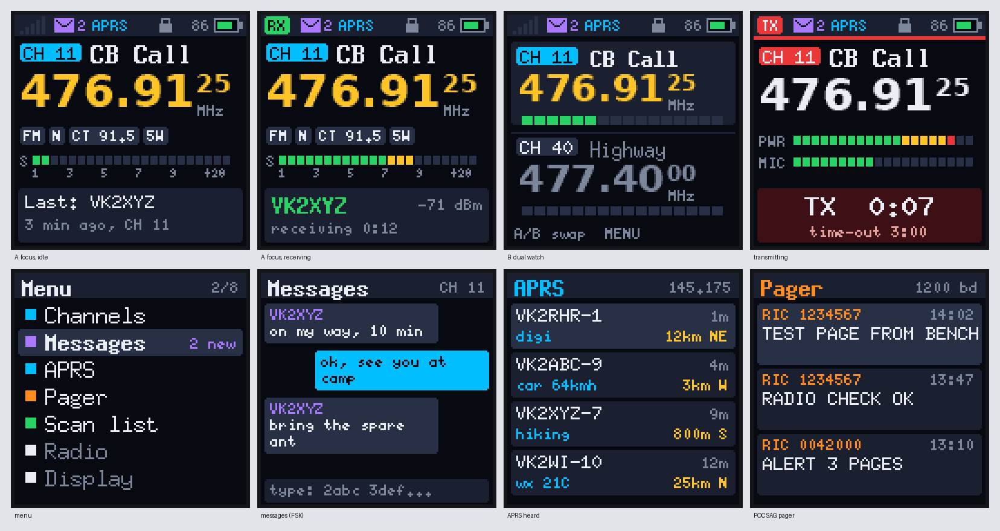

# Talkpod Super Firmware

Replacement firmware for the **Talkpod A36SE** (sold as the A36plus 5 W), written from scratch for
radio research. It keeps the radio's everyday functions and adds:
- a new two-slot user interface;
- text messaging compatible with UV-K5 radios;
- APRS and POCSAG paging;
- a wide transmit range;
- an animated boot splash.

Version **1.11**. Builds to about 45 KB of the MCU's 63 KB application flash.



> **Transmitting.** This firmware transmits wherever the BK4819 can synthesise: 18–660 and
> 840–1300 MHz. Two ranges are hard-blocked in code (`src/tx.c`):
> - **108–138 MHz** (aviation)
> - **406.0–406.1 MHz** (distress beacons)
>
> Everything else is up to the operator and their licence. It was developed with the radio in a
> shielded enclosure on a dummy load. The transmit power calibration is the radio's own, but
> spectral purity off the radio's designed bands has not been measured.

## Contents

| Document | What is in it |
|---|---|
| [docs/user-guide.md](docs/user-guide.md) | Screens, keys, menu, messaging, APRS, pager, splash |
| [docs/hardware.md](docs/hardware.md) | Everything learned about the radio: MCU, bootloader, pins, BK4819, RF switching, calibration, flash map, display, keys, audio |
| [docs/stock-firmware.md](docs/stock-firmware.md) | Reverse-engineering notes on the stock V1.22 Super firmware, with addresses |
| [docs/data-modes.md](docs/data-modes.md) | The BK4819 FSK modem as used here; UV-K5 messenger, APRS and POCSAG formats and implementations |
| [docs/serial-interface.md](docs/serial-interface.md) | Programming cable, flashing protocol, `.kdhx` format, the firmware's serial shell, **the splash format and how Talkpod Manager uploads it** |
| [docs/development.md](docs/development.md) | Source layout, building, the Unicorn emulator and other tools, what is verified on hardware |

## Features

| | Status |
|---|---|
| FM receive, wide / narrow | working on the radio |
| AM receive (airband channels automatic, any VFO frequency on request) | built, not yet checked with an AM signal |
| Squelch 0–9 from the radio's own calibration, widened for wide FM | working |
| Dual watch (two slots, each a channel or a VFO frequency) | working |
| Frequency search (strongest nearby carrier) | working |
| Channel scan with lock-out | working (VFO scan is in the code but not offered) |
| FM transmit with the radio's PA calibration, high / low power, time-out timer | working, voice heard on air (1.11; 1.0–1.10 sent a silent carrier) |
| Channels from Talkpod Manager / CHIRP: read and write over the stock programming protocol (1.1+) | working on the radio |
| Per channel: transmit frequency (repeater shift, split), transmit-off, busy channel lockout | emulator-tested |
| CTCSS / DCS sent and decoded (stock's register values), tone squelch in scan and dual watch | emulator-tested; on-air test pending |
| Voice scrambler (BK4819 inversion, the UV-K5's types 1 and 2) | working on air; weak: words stay partly understandable |
| UV-K5-compatible text messages (kamilsss655 format) with delivery receipts | emulator-tested; on-air test pending |
| APRS: beacons, messages, acks (AFSK 1200) | sending emulator-tested; receiving experimental |
| POCSAG pager, 512 / 1200 / 2400 bit/s, numeric and alphanumeric | emulator-tested; on-air test pending |
| Animated boot splash, changeable over the serial cable | working |
| Settings kept across power-off | working |
| Ten short sounds (key beep, menu, high / low, power-on, low voltage...) | working (built from the radio's own voice prompts) |

The firmware does **not** have yet:
- stock's per-channel "ENCRY", which is a private code squelch, not encryption (see
  docs/stock-firmware.md), and PTT-ID / DTMF signalling;
- the stock menu settings (VOX, roger beep, tail elimination, tone burst, alarm, side-key functions and so
  on); it keeps its own settings, set from its menu;
- the stock FM broadcast receiver (BK1080);
- channel editing on the radio (program channels with Talkpod Manager or CHIRP).

## Quick start

You need the programming cable (K-plug USB serial) and Linux with Python 3, pyserial and Pillow.
The flasher is `talkpod-firmware` from
[Talkpod Manager](https://github.com/ssjrocks/talkpod-manager).

1. **Flash** it. In Talkpod Manager 0.2 or later: main menu → **Flash firmware…** → Talkpod Super
   Firmware (it downloads the newest release). Or from the command line, the release's `.kdhx` (or
   `build/a36se-fw.kdhx`):
   ```bash
   talkpod-firmware flash talkpod-super-firmware-v1.11.kdhx
   ```
   This works from stock firmware or from this firmware, with no buttons to press. If the radio
   doesn't answer, switch it on while holding both side keys (white screen) and add `--manual`.
2. **Back up the 2 MB flash** before writing anything to it. It holds the channels, the
   calibration and the stock voice prompts:
   ```bash
   python3 tools/flash_backup.py --out backups/flash-$(date +%Y%m%d).bin
   ```
3. **Sounds (optional):** build the sound pack from your own radio's voice prompts. This erases
   the stock voice area (0x110000–0x191FFF); the backup keeps the prompts.
   ```bash
   python3 tools/soundpack.py backups/flash-YYYYMMDD.bin
   ```
   Without a pack the firmware runs silently.
4. **Boot splash (optional):**
   ```bash
   python3 tools/splash.py my-animation.gif --play
   ```
   Talkpod Manager can do the same: see
   [docs/serial-interface.md](docs/serial-interface.md#boot-splash).

To go back to stock firmware, flash the stock `.kdhx` with `talkpod-firmware`. The stock voice
prompts stay gone until the flash backup is written back; there is no restore tool yet.

## Building

```bash
sudo apt install gcc-arm-none-eabi libnewlib-arm-none-eabi gcc make
make            # build/a36se-fw.bin and build/a36se-fw.kdhx (tools/encrypt.c scrambles it)
make flash      # talkpod-firmware flash --yes build/a36se-fw.kdhx
```

The emulator and test tools are described in [docs/development.md](docs/development.md).

## Credits

- The register-level drivers started from
  [Jamie793/A36Plus_Radio](https://github.com/Jamie793/A36Plus_Radio) (MIT): LCD, keypad and
  BK4819 SPI.
- GigaDevice GD32F3x0 firmware library (BSD-3-Clause, `lib/`). It is register-compatible with the
  radio's Artery AT32F421 for clocks, GPIO, SPI and ADC, but not for the USART.
- The UV-K5 messenger packet format is from
  [kamilsss655/uv-k5-firmware-custom](https://github.com/kamilsss655/uv-k5-firmware-custom),
  after joaquimorg's original.
- The bootloader protocol was cross-checked with OpenRTX's `rtxflash`.
- Anti-aliased digits rendered from DejaVu Sans Bold (Bitstream Vera licence).

No licence has been chosen for this firmware yet.
